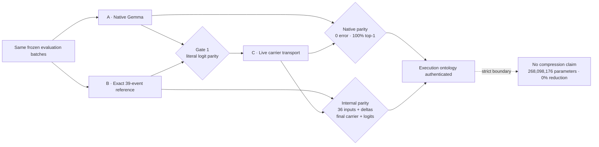
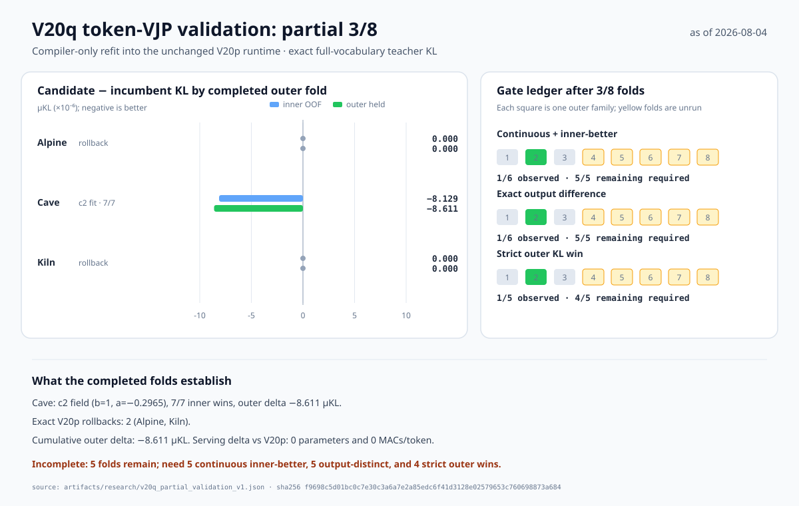

# Fisher Graph Compilation

An instrumentable transformer-compilation research framework. It analyzes a
frozen model in Fisher-weighted activation and parameter spaces, lowers the
result into modal generators and causal graph edges, and evaluates whether
those graph executors can replace native transformer computation.


```text
weights
  ↓
Fisher coupling
  ↓
parameter clusters
  ↓
computational modes
  ↓
modal generators
  ↓
generator interaction graph
  ↓
inference by graph traversal
```

The reusable compiler and runtime boundaries are implemented. The toy model
has validation-backed structural compression. Gemma 3 270M now has an
authenticated exact 39-event carrier-transport execution spanning tied lexical
ingress/egress, every attention and MLP mutation, the residual carrier, and
terminal normalization. This establishes the whole-model execution ontology;
it is deliberately full-width and is not yet a downstream-qualified compressed
graph or deployment result.

The historical experiment chronology and command archive live in
[`RESEARCH_LOG.md`](RESEARCH_LOG.md). This README focuses on the current
framework and the strongest recent results.

## Current attention-edge atlas and fidelity result

The current parts-first rung separates **attention structure discovery** from
**sparse execution fidelity**. Rather than treating an attention head as one
scalar generator, it reconstructs every allowed `(layer, head, query, key)`
route and records its probability, signed objective response, Fisher energy,
tangent contribution, and causal distance. The resulting atlas is a structural
map; it receives no compression, storage, latency, or semantic claim.

The experiment then asked a stricter question: can a small set of those edges
replace dense attention without changing model behavior? The retrospective A
curve compared global route budgets `K = (1, 2, 4, 8, 16)`, five rankers, and
zero-fill versus per-head renormalization. Its sparse replays used ordinal-
matched dense controls so CPU batch-shape rounding could not masquerade as an
edge effect. A separate prospective B panel froze the A-derived motif policy,
used no B gradients or target information for selection, and evaluated global
K8 zero-fill against six preregistered fidelity gates.

| Evidence | Retrospective A | Prospective B |
|---|---:|---:|
| Sparse policy | Fisher K8 zero-fill | Frozen A-motif K8 zero-fill |
| Selected-route share | `23.85%` | length-dependent, `15.1%`–`31.8%` |
| Fisher energy retained | `92.81%` | not used as a B acceptance shortcut |
| Dense/sparse top-1 agreement | `45/60` | `1/60` |
| Mean target-NLL change | `+0.439` | positive on all `60/60` rows |
| Valid-logit NRMSE | `0.508` | bootstrap U95 `0.920` |
| Preregistered verdict | discovery diagnostic only | all six fidelity gates failed |

The B controls passed cleanly: native and matched target-only references agreed
on top-1 for `60/60` rows, with maximum numerical drift of only `1.10e-5` NLL
and `7.63e-7` centered-logit NRMSE. The rejection therefore belongs to the
sparse edge policy, not the replay machinery. The teacher-operator gate also
failed before downstream propagation, showing that the frozen K8 motifs omit
locally important routes; residual, terminal, and logit composition then
amplify that loss.

The result is **structure yes, compression no**. High retained Fisher energy
does not by itself close the computation: a globally modest edge may be the
only support for one head, or several individually weak edges may form a
necessary coalition. K16 improved the A curve substantially, but B remains an
untouched rejection panel and must not be reused to tune a replacement policy.

The next edge representation should therefore be richer than
`(layer, head, query, key) -> scalar score`. It should combine route
probability, transported value direction, signed causal response, query/key
context, distance, cross-example stability, and redundancy or coalition
support. Selection should use per-head and per-layer minimums plus adaptive
K16/K32 budgets so a global ranking cannot starve a head. That richer policy
must be frozen on new discovery data and evaluated on another untouched panel
before it can support any compression claim.

The implementation is split across the exact
[`edge extractor`](src/fisher_graph/gemma3_parts_first_attention_edges.py),
[`atlas runner`](src/fisher_graph/gemma3_parts_first_attention_edge_experiment.py),
[`A fidelity kernel`](src/fisher_graph/gemma3_parts_first_attention_edge_fidelity.py),
[`A curve runner`](src/fisher_graph/gemma3_parts_first_attention_edge_fidelity_experiment.py),
[`B setup`](src/fisher_graph/gemma3_parts_first_attention_edge_fidelity_b_setup.py),
and [`B runner`](src/fisher_graph/gemma3_parts_first_attention_edge_fidelity_b_experiment.py).
The frozen prospective panel is
[`gemma3_attention_edge_fidelity_B_v1.json`](examples/gemma3_attention_edge_fidelity_B_v1.json).

## Framework architecture

```mermaid
flowchart LR
    subgraph offline["Offline analysis and compilation"]
        S["Frozen source model"] --> A["ModelAdapter"]
        C["Calibration stream"] --> A
        A --> T["Named activations and score gradients"]
        T --> F["Grouped Fisher coupling"]
        F --> K["Parameter clusters"]
        K --> R["Per-layer fragments"]
        R --> M["Computational-mode bases"]
        M --> G["Modal generators and selected edges"]
        G --> P["Authenticated ModalCompilerPipeline"]
    end

    subgraph candidate["Source-free candidate execution"]
        P --> E["All-at-once graph executor"]
        P --> I["Incremental graph session"]
        E --> V["NLL, KL, top-1, and structural gates"]
        I --> V
    end

    V -. "pass: separate integration gate" .-> RM["RuntimeManifest and compiled binding"]
    RM --> D["MixedSegmentDispatcher"]
    D --> CF["Compiled fast or inspectable path"]
    D --> SF["Native segment fallback"]

    V -. "residual evidence" .-> PC["Progressive compiler control plane"]
    PC -. "repair or compact mutation" .-> G
```



The architecture separates model-specific behavior, scientific analysis,
candidate compilation, and deployment authority:

| Boundary | Responsibility | Main implementation |
|---|---|---|
| Model family | Layers, semantic activation sites, masks, positions, dtype, and execution semantics | [`adapters/base.py`](src/fisher_graph/adapters/base.py), [`adapters/toy.py`](src/fisher_graph/adapters/toy.py), [`adapters/gemma3.py`](src/fisher_graph/adapters/gemma3.py) |
| Instrumentation | Capture named activations and score gradients without mutating source weights | [`instrumentation.py`](src/fisher_graph/instrumentation.py), [`modes.py`](src/fisher_graph/modes.py) |
| Fisher map | Estimate coupling, cluster parameters, and create layer fragments | [`parameter_fisher_coupling.py`](src/fisher_graph/parameter_fisher_coupling.py), [`fisher_prompt_clustering.py`](src/fisher_graph/fisher_prompt_clustering.py), [`parameter_cluster_fragments.py`](src/fisher_graph/parameter_cluster_fragments.py) |
| Modal compiler | Build computational modes, generators, edges, and authenticated artifacts | [`computational_modes.py`](src/fisher_graph/computational_modes.py), [`modal_generators.py`](src/fisher_graph/modal_generators.py), [`modal_compiler_pipeline.py`](src/fisher_graph/modal_compiler_pipeline.py) |
| Graph execution | Run a complete graph or advance it incrementally for inspection and intervention, including source-conditioned polynomial edge routing | [`modal_generator_graph.py`](src/fisher_graph/modal_generator_graph.py), [`modal_generator_graph_session.py`](src/fisher_graph/modal_generator_graph_session.py), [`state_conditioned_modal_fitting.py`](src/fisher_graph/state_conditioned_modal_fitting.py) |
| Validation and iteration | Score shadows, map residuals, propose mutations, and fail closed at declared gates | [`shadow_fidelity.py`](src/fisher_graph/shadow_fidelity.py), [`compiler/progressive.py`](src/fisher_graph/compiler/progressive.py) |
| Model runtime | Authenticate source identity and capabilities, then dispatch compiled or native segments | [`compiler/manifest.py`](src/fisher_graph/compiler/manifest.py), [`compiler/runtime.py`](src/fisher_graph/compiler/runtime.py) |

### Exact causal carrier-transport result

The causal carrier-transport rung unifies the exact residual identity,
attention routing, and MLP mutation under one live message abstraction. Each of
the 36 carrier boundaries receives exactly one parameter-free identity carry
and one exact generator message; the graph core, rather than a generator
callback, owns the state commit. Tied lexical ingress/egress and terminal
RMSNorm close the 39-event model. This is deliberately full-width and retains
all checkpoint coefficients, so it tests the execution ontology without
claiming compression, add elimination, kernel fusion, or speedup.


Authenticate its setup without loading Gemma:

```bash
fisher-graph-gemma-causal-carrier-transport-setup --check
```

Run the model-facing exact experiment with:

```bash
fisher-graph-gemma-causal-carrier-transport-dev \
  --output .local-runs/google--gemma-3-270m/causal-carrier-transport-exact-v1.json
```

The first exact run passed. Across 8 CPU-float32 prefill batches—30 prompts,
406 valid query rows, and 376 supervised tokens—the exact 39-event reference
and the live carrier-transport runtime both reproduced native Gemma literally.

| Evidence | Exact 39-event reference | Live carrier transport |
|---|---:|---:|
| Maximum logit error vs. native | `0.0` | `0.0` |
| Delta NLL/token | `0.0` | `0.0` |
| Native KL/query | `0.0` | `0.0` |
| Top-1 agreement | `100%` | `100%` |
| Source/projection/fallback calls | `0` | `0` |
| Stored parameters | `268,098,176` | `268,098,176` |



The live core owned all 36 carrier commits. Its 36 identity carries, 18
state-conditioned causal-attention messages, and 18 token-local MLP messages
matched the exact reference at every mutation input and delta, then at the
final carrier, normalized output, and logits. Both compiled arms made zero
source, projection, or fallback calls, and source and compiled states remained
unchanged.

This is the foundation, not the compression result. It contains no learned
cross-event corrections and establishes no parameter or byte reduction,
logical-MAC reduction, kernel fusion, cached decoding, latency improvement, or
source-free serialized artifact. The result lets edge learning and compression
become separate controlled variables. The frozen protocol SHA is
`19930ed077a6c0e8dfbcc1f4306b07ebba25c3ef3382732addf0c918491d3c3f`;
the first authenticated report SHA is
`5993a119c8864fa14d7745029bbd682b66388be1c438af38e01b2c3572d66dfd`.

`ModelAdapter` is the model-family boundary. Analysis code does not need to
know Gemma module paths or calling conventions. `RuntimeManifest` is the
deployment authority: it binds compiled resources to source state, source
configuration, live execution options, backend ABI, sequence capabilities,
and validation state. If those checks do not match, the mixed runtime uses the
declared native fallback rather than silently running an invalid graph.

Fast and inspectable execution are distinct. The fast path can use fused or
factorized tensors; the inspectable path preserves named logical activations
and interventions. Both must represent the same authenticated segment before
either can replace source computation.

### State-conditioned flow edges

The graph now has an opt-in interaction whose effective value changes with
each token's final source-modal state. For source coordinates `z`, each edge
stores a compact proposal

```text
d_ij(z) = z M_ij + b_ij + ((z A_ij) * (z C_ij)) B_ij
```

and a source-only routing logit `a_ij(z) = z g_ij + g0_ij`. Outgoing edges in
one routing group are normalized together, stable top-k selection is applied
per token, and only selected token/edge rows evaluate the polynomial proposal.
The executor can lazily capture route weights, weighted edge messages, and
the exact number of proposal rows evaluated.

Teacher flow is fit-only. It may assign candidate routes by displacement
direction and relative flow error, but the fitted router is algebraically
folded into copied gate coefficients; no native output, Fisher profile,
target, calibration row, or source callback enters the serving artifact.
Legacy affine interactions and their hashes remain unchanged. Dense-candidate
MACs remain the conservative graph total, while routing MACs and the
selected-message upper bound are reported separately; quadratic Hadamard
products and route scaling are also reported as elementwise multiplications
rather than being hidden inside MACs.
The first offline fitter uses hard teacher assignments and therefore emits
top-1 groups only. The runtime supports wider top-k groups, but fitting those
correctly requires responsibility-weighted expert targets. The fitter also
audits the algebraically folded router on fit and optional validation rows in
float32, and refuses an artifact when centering/scale removal would change a
route or exceed its numerical error bound.

This rung implements `t_ij(z_i)` and `pi_ij(z_i)` over already-lowered
computational-mode coordinates. Explicit hidden-state charts
`(mu_i, B_i, G_i)` and normalized source membership `q_i(h)` remain a later
node-level geometry rung; they are not implied by the new edge alone.

## Recent successes

These are the proof points that currently matter, rather than a chronology of
every attempted parameterization.

| Result | Evidence | What it establishes |
|---|---|---|
| Gemma exact causal carrier transport | Native, the exact 39-event reference, and the live carrier-transport graph agreed literally across 8 batches and 406 valid query rows: `0.0` maximum logit error, delta NLL, and KL; `100%` top-1; zero compiled source or fallback calls | The complete tied-lexical, attention, MLP, residual-carrier, and terminal-normalization execution can be expressed under one live message ontology. It retains all `268,098,176` parameters, so this is the foundation for controlled edge and compression experiments—not compression itself. |
| Toy whole-span graph executor | `19,064` versus `27,872` deployment parameters (`31.60%` fewer); ideal complete matrix work is `60.70%` of native; zero native-block calls; exact behavior on 246 fresh validation contexts | Validation-backed structural compression on the narrow associative-recall task. The reserved 250-context executor test remains sealed. |
| Gemma structured-layer replacement | Validation block NRMSE `9.21e-7`, top-1 `100%`, and zero source-layer calls | The adapter, activation-only fit, artifact, and replacement boundary can reproduce a real Gemma layer. The retained native shape means this is parity, not compression. |
| Gemma 18-generator MLP stack | `20.90%` logical whole-model parameter reduction and `79.17%` of native MLP matrix MACs removed; trajectory refit reduced excess NLL by `57.1%` to `+0.149649`, with `81.02%` native top-1 | A real full-stack rate/distortion point. Fidelity is still below acceptance, so it is open-development evidence rather than qualified compression. |
| Gemma same-layer conditional graph | A frozen `0.5x` signed edge field improved NLL over its edgeless control on selection (`4.959437 → 4.956374`) and a family-disjoint Calibration-A guard (`5.365105 → 5.358906`). Replacing 230 of 2,048 layer-17 MLP modes stores `133,187` versus `441,600` slice parameters (`69.84%` fewer) and executes `126,816` versus `441,600` slice matrix MACs/token (`71.28%` fewer). | The authenticated graph, continuous gain, compiler promotion, and lazy top-1 edge routing all work on real Gemma execution. This is a partial one-layer result: it saves only `0.115%` of whole-model parameters, retains an `+0.088108` guard NLL gap to native, and makes no end-to-end FLOP, kernel, or latency claim. |
| Gemma native-qualified task-retention pilot | Native, edgeless, and the frozen graph each answered `56/60` declared-label items (`93.33%`) under restricted four-choice, single-next-token scoring. The graph preserved `55/56` native-correct answers (`98.21%`) and improved restricted-choice NLL over native (`0.291654 → 0.283670`) and edgeless (`0.284314 → 0.283670`). | The candidate was not executed during within-V2 native-only family qualification, but an earlier candidate diagnostic informed the V2 bank design. The partial slice cleared every declared 90% retention gate; a later audit found multiple-valid-answer templates in the loss/repair family, so this is a promising post-candidate handcrafted diagnostic—not generative, standardized, fresh, or whole-model qualification. |
| Complete-H4 Fisher subspace | The D320 + K256 arm retained `576/640` tested directions and reached ordinary `+0.00056` ΔNLL, `0.00364` KL, and `96.89%` top-1 while passing the established aggregate, prompt-robustness, and geometry gates | Fisher-ranked state can preserve nearly all measured downstream behavior at one complete residual boundary. The rank grid and native tail make this hypothesis evidence, not a deployable provider. |
| Compact mixed-mode generator edge | The bilinear branch stores `6,880` coefficients versus `172,032` dense (`96.00%` fewer); the three-branch graph stores `46,816` versus `958,464` (`95.12%` fewer). Fresh fixed-reference error improved `0.2090 → 0.1694`, cosine `0.9871` | Compact generators can transport known nonlinear mode interactions across positions. The reference provider and surrounding model are excluded, so this is not whole-model compression. |

The prepared 18-generator CPU runtime also measured batch-one fused speedups of
`1.50–1.73x` for prefill and `1.26–1.28x` for cached decode at contexts
32–256. Those are scoped PyTorch/CPU measurements of a separate float32
rate/distortion point, not GPU or downstream-quality-qualified latency.

The toy executor remains the only validation-backed structural compression
result. Gemma now has an exact whole-model carrier-transport execution, but its
compressed candidates have not yet closed the full-model fidelity gate.

## Latest Gemma result: guarded state-conditioned modal flow

Four disjoint top-Fisher fragments from Gemma layer 17 were lowered to modal
generators, replacing 230 of that MLP's 2,048 modes. All four width-32 modal
nodes still execute for every token; only the three edge proposals are lazy.
One source state routes a polynomial correction with factor rank 8 to one of
three target fragments per token. Generator-private rank is 16. The first
full-strength candidate missed its edgeless control by `0.003268` NLL/token,
so it was not promoted and the guard remained sealed.

After that V1 failure was observed, a second-stage signed gain sweep was
declared before its selection scores were materialized. It scaled the frozen
message field without refitting its router or polynomial coefficients. The
curve was directional: negative gains all regressed, positive gains improved
through `0.5x`, and the full `1.0x` field overshot. The frozen `0.5x` candidate
strictly beat its edgeless selection control and transferred to four
family-disjoint Calibration-A examples. That guard is open-development
evidence (`heldout_confirmation=false`, `fresh_validation=false`), not external
validation.

| metric | native | edgeless | guarded `0.5x` graph | graph vs edgeless |
|---|---:|---:|---:|---:|
| NLL/token | `5.270798` | `5.365105` | `5.358906` | `-0.006199` |
| native-to-candidate KL/token | `0` | `0.118818` | `0.119856` | `+0.001038` |
| top-1 agreement with native | `100%` | `78.78%` | `77.34%` | `-1.44 pp` |

This is a real but narrow success. The edge recovers `6.57%` of the edgeless
guard NLL gap, while its ordinary flow NRMSE remains worse than the zero-flow
control (`1.0364`). That mismatch says downstream likelihood sees a useful
small direction that Euclidean flow error does not rank well. It does **not**
show native-equivalent fidelity or whole-model compression. The checked-in
[`source-safe guard summary`](artifacts/research/state_conditioned_shape_flow_guard_v2.json)
contains the exact hashes, metrics, accounting, and claim boundary without
prompts, token rows, activations, gradients, or weights.
Downstream evaluation requires both the originating host's private pre-open
claim ledger and the exact frozen guard-assessment SHA-256. That makes the
lineage tamper-evident here, but it is not yet a portable signed completion
receipt.

The next task-level rung cleared its declared-label pilot gates without
changing the candidate. It is a post-candidate audit rather than fresh
validation: an
initial 60-item panel was correctly declared inconclusive because native Gemma
could solve only three of its six families reliably, even though the graph
preserved all `34` native-correct answers and repaired one. V2 fixed the
denominator rather than the gate: native alone scored five qualification
items from each of eight new families, the first six capable families were
frozen, and only then were native, edgeless, and candidate allowed to score ten
disjoint items from each selected family. The earlier V1 candidate result did,
however, inform the V2 bank redesign.

| forced-choice metric | native | edgeless | guarded `0.5x` graph |
|---|---:|---:|---:|
| correct / 60 | `56` | `56` | `56` |
| declared-label accuracy | `93.33%` | `93.33%` | `93.33%` |
| restricted-choice NLL | `0.291654` | `0.284314` | `0.283670` |
| native-correct answers retained | — | — | `55/56` (`98.21%`) |

The graph lost one native-correct item, repaired one native error, and changed
one additional both-wrong choice. Those three prediction changes give `95.0%`
exact choice agreement and no net declared-label accuracy loss. Candidate and
edgeless had identical per-item correctness. The conditional edge's `0.000644`
restricted-choice NLL gain is therefore a calibration/ranking improvement,
not an accuracy improvement; it accounts for about `8.1%` of the candidate's
restricted-choice NLL gain over native. The item-level
one-sided 90% Wilson lower screen is `94.22%`, but the rows are templated and
family-clustered, so that number is descriptive rather than a population
confidence claim. All six native-qualified families remained frozen through
evaluation and cleared the family-loss gates. Task retention and conditional
edge value are reported as separate claims.

A post-run label audit found that `object_material`, `animal_movement`, and
`country_continent` contain prompts with multiple defensible answers or
regional naming conventions. The sole loss-and-repair pair occurred in
`object_material`, so `55/56` is the exact declared-label result but not strong
enough for an external downstream claim. The
[`source-safe task summary`](artifacts/research/state_conditioned_downstream_retention_v2.json)
contains the frozen hashes, paired counts, gates, label-audit caveat, and
accounting without task
text, token ids, logits, activations, gradients, or weights.

The flow audit still isolates the next fidelity bottleneck: coordinates and
runtime capture close below `6.5e-7`, but fitted messages with oracle routing
still reach weighted NRMSE `1.1281`. The current 32-dimensional
source-generator state is not yet the intended chart of the 640-dimensional
incoming hidden state. The
pilot warrants an external standardized task subset before the clean
scope-generalization test: run the same one-source/three-target topology
independently at layer 10 on fresh development and guard families. That slice
projects `641,280 → 133,187` parameters and `641,280 → 126,816` executed matrix
MACs/token (`79.23%` and `80.22%` local savings). Only if both gates pass should
layers 10 and 17 be composed. Explicit hidden-state charts and membership
weights remain unimplemented; a shared chart ladder is the
bounded capacity rung before adding more routes to layer 17.

## Earlier Gemma result: V20q token-VJP refit

V20p showed that the existing one-boundary runtime can express a genuinely
per-token local signed field. It selected adaptive, nonconstant, zero-crossing
fields in `5/8` held families and beat the base arm in `5/8`. Its macro exact
KL (`1.28308704`) was still worse than the fixed-minus control
(`1.28293039`), so it rolled back and authorized no provider or deployment
claim.

V20q asks whether the runtime form is useful but the V20p fit is weak. For
each outer family it:

1. removes that family from fitting and selection;
2. runs seven inner family folds;
3. searches `174` logical candidates, including `168` continuous fits over
   `c1`, `c2`, `c1*c2`, and `source_z`;
4. derives coefficient directions from exact token-VJP Fisher geometry; and
5. scores the frozen selection once with float64 full-vocabulary teacher KL.

The refit is compiler-only. It lowers into the unchanged V20p executor and
adds `0` serving parameters and `0` MACs/token relative to V20p.

[](docs/images/v20q-partial-validation.svg)

| completed outer fold | V20p incumbent | V20q selection | inner ΔKL | inner wins | outer ΔKL | result |
|---|---|---|---:|---:|---:|---|
| Alpine | `c1, b=0.5, a=-1` | exact rollback | `0.000 µKL` | `0/7` | `0.000 µKL` | no output change |
| Cave | `source_z, b=1, a=0` | `c2, b=1, a=-0.2965` | `-8.129 µKL` | `7/7` | `-8.611 µKL` | output-distinct strict outer win |
| Kiln | `c1, b=0.5, a=-1` | exact rollback | `0.000 µKL` | `0/7` | `0.000 µKL` | no output change |

Cave is the first clean result in this campaign: a continuous token-VJP fit
won all seven inner families and transferred to an untouched outer family.
Alpine and Kiln selected the exact incumbent, so their outputs and scores did
not change.

### Current gate

| gate | observed / required | needed from the five remaining folds |
|---|---:|---:|
| continuous and inner-better selection | `1/6` | `5/5` |
| exact output difference | `1/6` | `5/5` |
| strict outer KL win | `1/5` | `4/5` |

The eight-fold campaign is incomplete but still mathematically reachable.
All five remaining folds must select continuous, output-distinct fits, and at
least four must win on the untouched outer family. One more exact rollback
makes the first two gates impossible.

This partial result authorizes no final fidelity, fresh-validation, serving,
compression, parameter-reduction, FLOP-reduction, or speed claim. The chart
is generated deterministically from the checked-in
[`source-safe V20q summary`](artifacts/research/v20q_partial_validation_v1.json),
which contains no prompts, weights, token tensors, activations, or gradients.

If the frozen gate becomes unreachable, the next bounded rung is an
incumbent-centered iterative trust region with exact training-KL acceptance,
not a broader candidate search against the held families.

## Implemented now and next

| Implemented | Remaining production or research gate |
|---|---|
| Toy and Gemma adapters with semantic activation catalogs, variable-length prefill inputs, and source fingerprints | Additional model-family adapters and a stable backend-neutral symbolic sequence IR |
| Named source and compiled activation capture through one instrumentation contract | Broader compiled-site coverage and distributed Fisher collection for larger models |
| Exact and streaming Fisher analysis, parameter clustering, computational modes, generator plans, and causal edges | Robust mode selection and nonlinear transport that transfers across families and layers |
| Authenticated modal compiler artifacts with affine and state-conditioned polynomial edges, all-at-once traversal, incremental traversal, Gemma device execution, strict conditional-edge promotion, and family-disjoint guard assessment | Explicit hidden-state chart/membership artifacts and a conditional message fit that improves both geometric flow and downstream behavior |
| Manifest-aware compiled/native dispatch with capability checks and source fallback | Cache ownership, cache-aware decode, sliding-window kernels, and efficient dynamic GPU lowering |
| Progressive map→mutate→guard control flow with separated fit, selection, assessment, and reserved roles | Downstream-qualified whole-model compression, measured end-to-end GPU latency, and fresh task validation |

The Gemma adapter is currently prefill-only; cache-aware decode is not an
implemented model-adapter capability. MLX and custom Metal paths exist as toy
and boundary experiments, not as a complete Gemma runtime or general GPU
speed claim.

## Quick start

The core repository requires Python 3.10 or newer:

```bash
python -m venv .venv
source .venv/bin/activate
pip install -e ".[dev]"

python -m pytest
fisher-graph-experiment
fisher-graph-verify
```

Regenerate the committed figures:

```bash
fisher-graph-plot-research
fisher-graph-plot-optimizations
fisher-graph-plot-v20q-progress
```

Gemma experiments are opt-in. Accept the model license on
[Hugging Face](https://huggingface.co/google/gemma-3-270m), keep weights in an
external cache, and install the optional dependencies:

```bash
pip install -e ".[dev,gemma]"
hf auth login

fisher-graph-gemma-l3-l4-complete-h4-soft-polarity-v20q-token-vjp-nested --help
fisher-graph-gemma-downstream-retention-v2 --help
```

No Gemma model weights or local tensor artifacts are committed. Source-safe
result summaries omit prompt text, token IDs, activations, and gradients.
Development runs default to the ignored `.local-runs/` tree. Historical and
specialized experiment commands are documented in
[`RESEARCH_LOG.md`](RESEARCH_LOG.md) and the linked protocol documents.

## Documentation

- [Compiler architecture](docs/compiler-architecture.md) — interfaces,
  sequence semantics, manifests, runtime dispatch, and backend roadmap.
- [Modal-generator compiler](docs/modal-generator-compiler.md) — parameter
  clustering through executable graph traversal.
- [Progressive compilation](docs/progressive-compilation.md) — guarded
  iterative fitting and the complete-H4 research protocol.
- [Structured Gemma layer executor](docs/structured-layer-executor.md) — exact
  external-model replacement boundary.
- [Conditional computation](docs/conditional-computation.md) — toy reference,
  routing contracts, and clean V2 validation.
- [Recursive modal hierarchy](docs/recursive-modal-hierarchy.md) — L3→L4
  generator, spectral, wavelet, and provider work.
- [Historical research log](RESEARCH_LOG.md) — prior experiments, rejected
  variants, detailed metrics, and command archive.

## Scientific claim boundaries

The repository uses narrow claim language:

- **Verified reference** means a committed artifact passed its declared
  equivalence and replay controls.
- **Parity** means a candidate reproduces a source boundary but may save
  nothing.
- **Open development** means the data helped choose the next experiment and
  cannot be reused as fresh confirmation.
- **Shape-only** means a parameter or MAC count excludes a required provider,
  router, retained model component, or runtime cost.
- **Rejected** means one frozen candidate missed its gates; it does not prove
  the entire method impossible.
- **Measured latency** is limited to the reported device, backend, shape,
  batch, dtype, and timing protocol.

Source-safe reports commit aggregates, hashes, provenance, and explicit claim
boundaries. Model data and large tensors remain local. Passing a local
reconstruction gate does not automatically authorize serving, compression,
speed, or whole-model claims.

## Repository layout

```text
src/fisher_graph/        adapters, analysis, compiler, graph plans, and runtimes
tests/                   unit, artifact, replay, leakage, and stale-figure checks
docs/                    architecture and experiment-specific protocols
docs/images/             deterministic source-backed SVG summaries
artifacts/               committed toy artifacts and source-safe reports
examples/                prompt/split scaffolding and toy examples
.local-runs/             ignored local Gemma tensors and reports
RESEARCH_LOG.md          historical experiment chronology and command archive
```

The immediate research question is whether token-VJP fitting can turn the
measured complete-H4 Fisher structure into a field that transfers consistently
across all held families. Closing that gate is the next step toward promoting
the modal graph from an analysis artifact to a faithful model-level executor.
